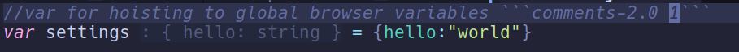
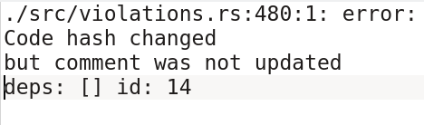
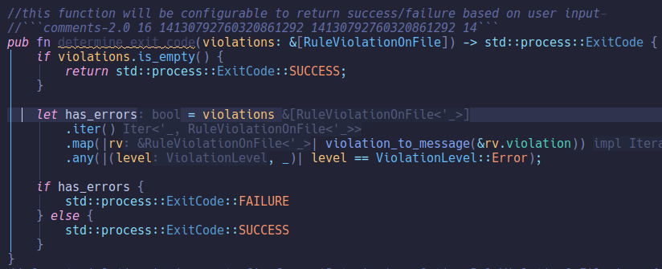
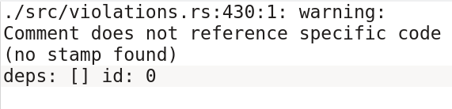
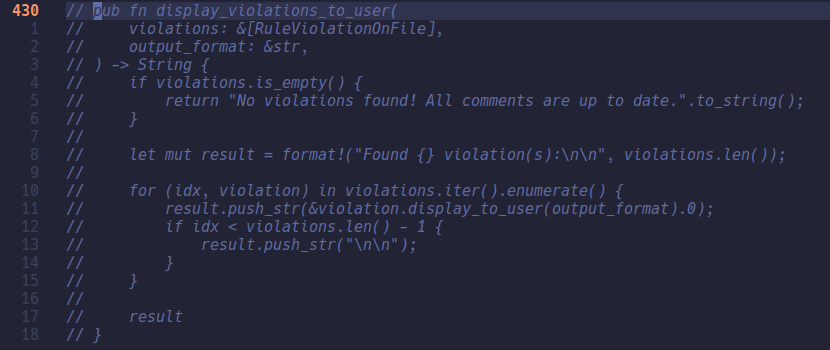
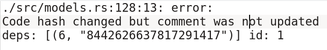
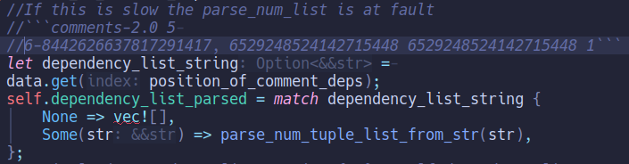

## The problem

- Comments are not uniformly handled within a project.
- Rules for them are arbitrary and not statically enforced.
- Comments consume precious code review time.
- Comments are treated as a second-class citizen compared to code.

Arguments from both sides of the debate:

| No comments | Comments |
| --- | --- |
| Code should be self-explanatory. | Prose can express a wider variety of concepts. |
| Maintenance burden | Onboarding can be easier. |
| Redundancy | Present limitations can be documented. |
| Compiler can check code | Domain knowledge is shared. |

## The solution: Comments-Toolkit

Arguing about no-comments vs. comments is like arguing about tabs vs. spaces. We solved that debate with tooling years ago: we use it in editors, configure projects with it, and we barely talk about it anymore. Instead of wasting time on conventions, we relied on tooling.

**Proposal:** Comments-Toolkit handles comments more rigorously, in a way similar to code, with checks in:

- CI pipelines
- Local hooks
- Editor tooling

### How it works

- A parser for C-like comments (more languages in the future).
- Developers *stamp* their comments with additional data:
  - Lines of code below the comment that the comment references
  - Dependencies on other comments
  - (More fields in the future, if there are interesting ideas)

### What the checker looks for

- Unstamped comment (does not reference specific code).
- Comment hash not generated yet (stamped by the developer but not yet by the tool).
- A comment that others depend on has been changed or deleted.
- Dependency on a comment that does not exist.
- Dependency on a comment that has been changed (so we can review that we are still OK with it).

Violations are emitted for each of those checks in the desired format (editor / GitHub pipelines). Each violation has a level: **Warning**, **Error** or **Note**, configurable per check with a config file.

### Examples

**Not updating the comment**

**Comment that does not reference code (unstamped)**

**Comment has a dependency**

## Ways to use it

- Pre-commit git hook (implemented)
- GitHub Actions (implemented)
- LSP in editor (TODO)

## Design goals

- No external services
- Reasonably fast
- Frictionless DX (TODO)
- Incremental adoption (TODO)

## Roadmap to V1

- Support all popular programming languages.
- Property-based testing to catch weird bugs sooner.
- More extensive beta testing on small/individual projects.

## Future ideas

- Support all programming languages.
- LSP support to use it smoothly inside editors.
- Cross-project/repo comment references (useful for workarounds for bugs in upstream projects).
- Tree-sitter-based parsing instead of a hand-written parser.
- Grammar-aware stamping of comments (something similar to tree-sitter selectors).

## Links

- [GitHub](https://github.com/georgefkd/comments-2.0)
